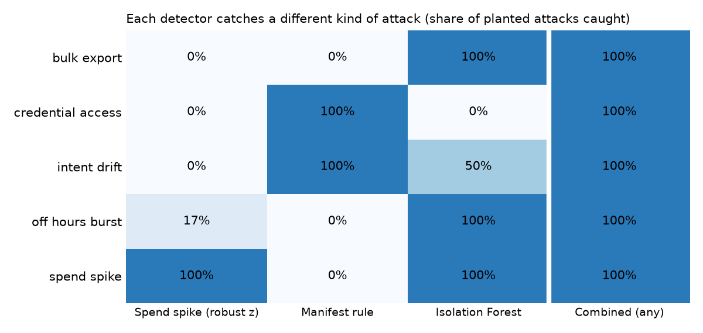

# Agent Drift Detector

When Varonis announced AI Detection & Response in November 2026, the posts described *what* it flags in AI agent activity: spend spikes, bulk exports, secret access, and agents acting outside their declared purpose. They didn't say *how* you'd decide something is abnormal. That's an anomaly detection problem, which is what I work on day to day at Honeywell, so I spent an afternoon prototyping one way to do it.

**Result:** on simulated agent logs, three simple detectors working together caught **30 of 30** planted attacks at about **0.6 false alarms per day** across 40 users. No single detector caught more than 21 on its own.



## What I built

AI agents now call tools on people's behalf: reading tickets, querying a warehouse, drafting emails. I simulated 30 days of that activity (40 users, 4 agent types, 33,755 tool calls) and hid 30 attacks in it, six each of five kinds:

| Attack | What it looks like |
|---|---|
| Spend spike | Same tools, about 15x the usual tokens (a runaway loop or a stolen key) |
| Bulk export | An allowed tool pulling thousands of records |
| Credential access | An agent reading secrets it has no business touching |
| Off-hours burst | Dozens of calls between 1 and 4 AM |
| Intent drift | A ticket summarizer suddenly calling CRM or warehouse tools |

I also planted a dozen legitimately busy days, like an end-of-quarter crunch, so the false-alarm numbers wouldn't be flattering.

The data is synthetic because real agent logs are private. The upside is that I know exactly where every attack is, so I can measure the detectors honestly.

## How it detects

Every user-agent-day gets summarized into a handful of behavior features, each compared against **that user's own normal**, since a heavy user making 200 calls isn't suspicious but a light user doing it is. Then three detectors look at each day:

| Detector | How it works | What it's good at |
|---|---|---|
| Spend spike | Robust z-score (median and MAD) of daily tokens, per user | Runaway cost |
| Manifest rule | Flags any tool call outside the agent's allowed list | Credential access, intent drift |
| Isolation Forest | Unsupervised model on the shape of a day's activity | Bulk exports, off-hours bursts |

An alert fires if any of them flags the day. The Isolation Forest uses a fixed alert budget (the top 2% of days) rather than a guessed threshold, because in practice the real limit is how many alerts an analyst can actually look at.

## What I learned

- **Rules and ML need each other.** The manifest rule caught every credential grab and every intent drift with zero false alarms, but missed every bulk export. The Isolation Forest was the reverse: three quiet `secrets.read` calls look completely normal in volume, so it never flagged them.
- **Small domain decisions beat model tuning.** My first version flagged unusually *quiet* days, like one call on a Sunday, because those are rare too. Telling the model that only above-normal activity matters fixed that. In security, a quiet day isn't a threat.
- **The false alarms are the interesting part.** The days it wrongly flagged were the busy decoy days: unusual, but harmless. Cutting those needs context the logs don't have, like a release calendar or an on-call roster.

## What this isn't

It's a prototype, not production code. It hasn't seen real traffic, and I designed the attacks myself, so real-world numbers would be lower. What I'd take from it is the approach: per-user baselines, rules where the policy is clear, ML for the subtle cases, and evaluating against an alert budget.

## If I kept going

- Add the context the logs lack (release calendars, on-call schedules) to cut false alarms
- Look at the *order* of tool calls, not just which tools were used
- Score events as they stream in, instead of once a day

## Run it

```
pip install -r requirements.txt
python generate.py
python features.py
python detect.py
python evaluate.py
```

Results land in `results/`.

*Built by Irfan Mohammed, a data scientist working on anomaly detection and predictive maintenance at Honeywell.*